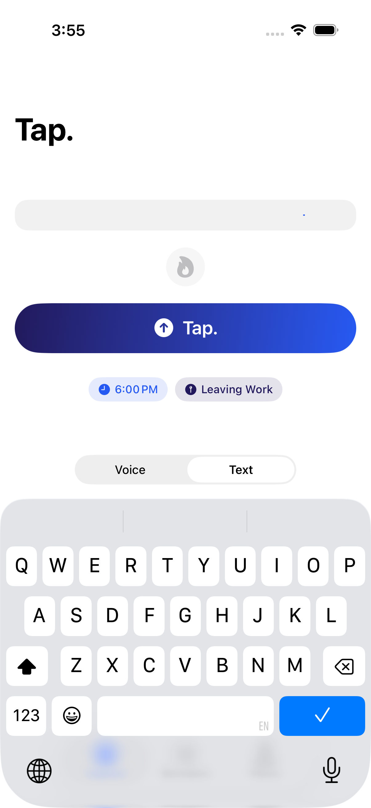
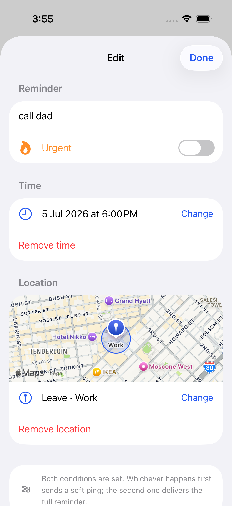
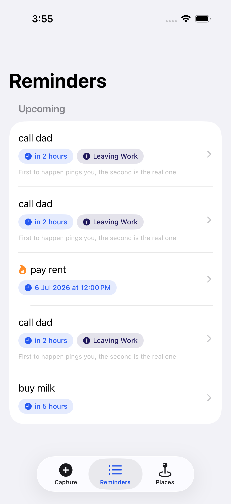
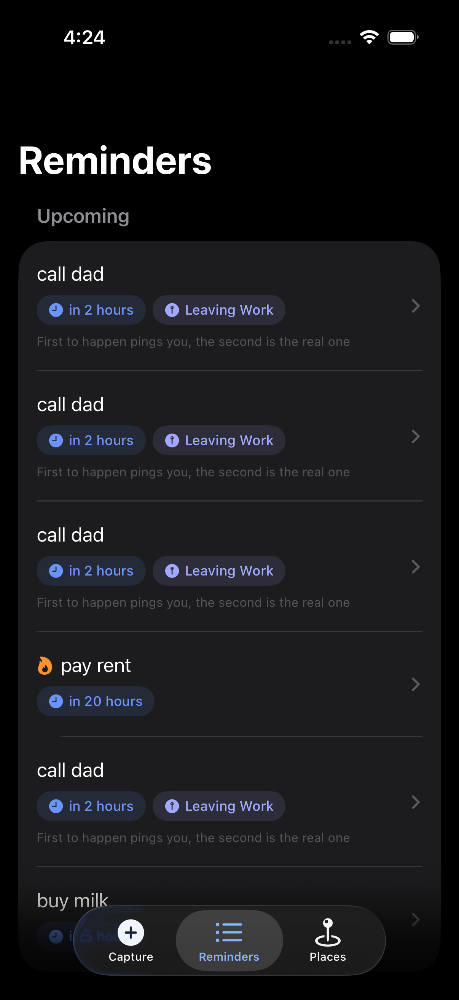
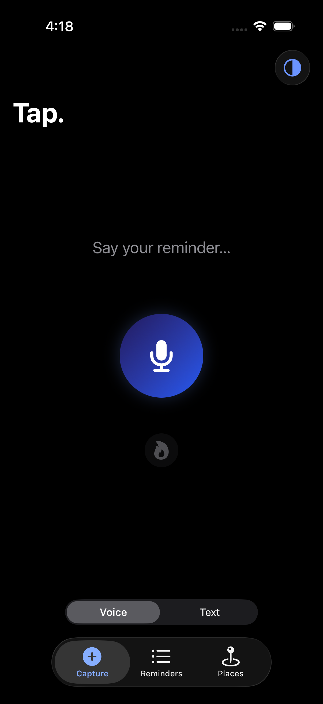

# Tap.

**Sub-3-second reminder capture.** Say it or type it — Tap parses the time, the place, and the urgency, saves instantly, and gets out of your way.

> "Call dad at 6 pm when I go out from work" → 🕕 6:00 PM · 📍 Leaving Work · saved.

<p align="center">
  
  
  
  
  
</p>

## Features

- **Voice & text capture, equal priority** — the app opens in whichever mode you used last. Voice auto-stops after 1.5 s of silence and speaks back what it understood; text commits silently with a haptic.
- **Live parse chips** — as you type or speak, pills appear showing the detected time, place, and urgency *before* you save.
- **Natural language parsing** (rule-based, on-device):
  - times: "6pm", "tomorrow at 9:30", "next monday", "tonight", "in 20 minutes", "after 2 hours"
  - places: saved places (Home, Work…) with arrive/leave triggers — "when I get to", "when I go out from", "before I leave"
  - urgency: `!!`, the word "urgent", or the flame toggle
- **Time + location race mode** — if a reminder has both conditions, whichever happens **first** sends a quiet ping; whichever happens **second** delivers the full reminder.
- **Geofencing** — saved places or one-off dropped pins, arrive or leave, 150 m default radius, works in the background.
- **Notification stacking** — several reminders at the same place fire as one combined notification.
- **Done / Snooze (30 min) actions** right on the notification; tapping it opens the reminder.
- **Safe place deletion** — deleting a saved place warns you with the list of affected reminders first.
- **Dark mode** with an in-app System/Light/Dark toggle and adaptive brand colors.

## Architecture

SwiftUI · SwiftData · iOS 17+

| Layer | Files |
|---|---|
| Capture | `CaptureView` (chips, orb, gradient), `VoiceCaptureController` (speech + silence auto-stop + TTS), `CaptureParser` (rule-based NL parsing) |
| Data | `Reminder`, `SavedPlace` (SwiftData models) |
| Scheduling | `NotificationScheduler` (content + calendar triggers), `GeofenceManager` (CLLocationManager regions), `RaceCoordinator` (race logic + stacking) |
| Notifications | `NotificationDelegate` (foreground banners, tap-to-open, Done/Snooze actions) |
| UI | `ReminderListView`, `ReminderDetailView` (edit + map card), `SavedPlacesView`, `PlaceEditView`, `Theme` |

The race trick: iOS can't rewrite a *delivered* notification, but it **can** rewrite a *pending* one. The time leg is pre-scheduled with soft-ping content (correct if time fires first); if the geofence fires first, the still-pending time notification is rewritten to full content.

## Building

```bash
brew install xcodegen
xcodegen generate
open Tap.xcodeproj
```

Runs in the Simulator out of the box. For a real device, set your Team under **Signing & Capabilities**. Voice capture and real geofencing need a physical iPhone.

## Testing

```bash
xcodebuild test -scheme Tap -destination 'platform=iOS Simulator,name=iPhone 17 Pro'
```

XCUITest covers: place creation on the map, time-only capture, both-conditions race capture, `!!` urgency, and the place-deletion warning. `test9_screenshotTour` regenerates the screenshots above.

## Roadmap

- [ ] Arabic capture (script + speech locale), beyond the current transliterated phrases
- [ ] Urgent escalation — re-alert until acknowledged
- [ ] Bare-hour times ("at 7")
- [ ] App Store release
